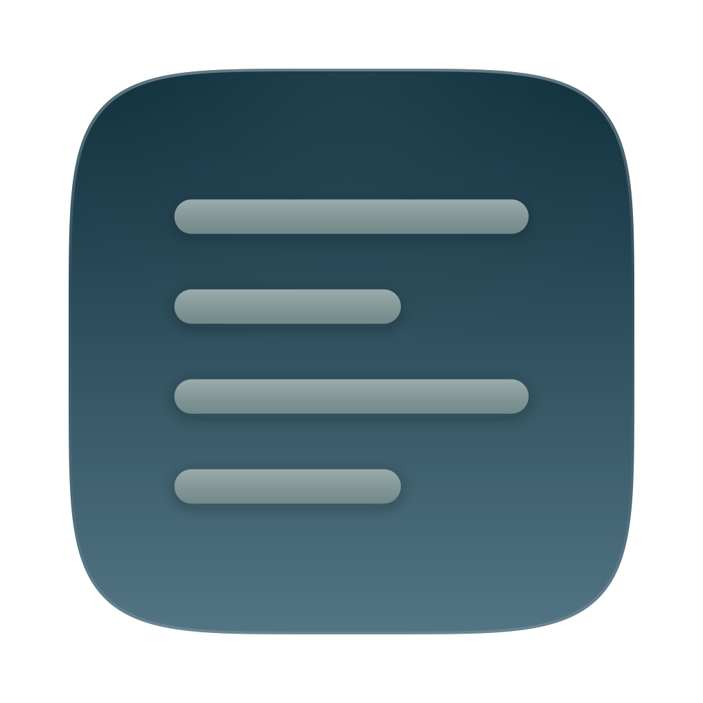

FromScratch
===========

## A simple but smart note-taking app

FromScratch is a little app that you can use as a quick note taking or todo app.

Version 3 is a native macOS rewrite of the same app, written in Swift and AppKit with no web views and no third-party packages. It reads and writes the same `~/.fromscratch/content.txt` as before. The 2.x line, built with Electron, stays on the `master` branch and is the last cross-platform one: v3 runs only on macOS 15 or later, on Apple Silicon.

* Small and simple, the only UI is the text you type
* Saves on-the-fly, no need to manually save
* Automatic indenting
* Use checkboxes to keep track of your TODO's
* Powerful keyboard control
* Replaces common syntax with symbols, such as arrows, through the ligatures of the bundled Fira Code. They depend on the font, so a different font may not have them
* Dark and Light theme, plus any colour scheme you drop in as an `.itermcolors` file
* Any monospace font installed on your machine, at any size
* Free

Note-folding and portable mode are 2.x features that 3.0 does not include.

> This is a fork of [buzkall/fromscratch](https://github.com/buzkall/fromscratch), which is itself a fork of the original [Kilian/fromscratch](https://github.com/Kilian/fromscratch) by [Kilian Valkhof](https://kilianvalkhof.com). buzkall did the work of getting the app building and running on current macOS; this fork adds an Apple Silicon build pipeline, a new app icon, and the native v3 rewrite. See [Fork notes](#fork-notes) for what changed at each step.

### Shortcuts

| Shortcut | Action |
| --- | --- |
| `cmd+w` | Close the window |
| `cmd+q` | Quit |
| `cmd+z` / `shift+cmd+z` | Undo / redo |
| `cmd+f` | Find |
| `opt+cmd+f` | Find and replace |
| `cmd+g` / `shift+cmd+g` | Find next / previous |
| `cmd+e` | Use selection for find |
| `cmd+l` or `cmd+/` | Add or toggle a checkbox |
| `tab` / `shift+tab` | Indent / outdent the selected lines (a tab character when nothing is selected) |
| `cmd+d` | Delete the current line |
| `opt+cmd+up` / `opt+cmd+down` | Move the current line up / down |
| `ctrl+g` | Jump to a line (`line` or `line:character`) |
| `cmd+i` | Toggle between light and dark theme |
| `cmd++` or `cmd+=` | Increase the text size |
| `cmd+-` | Decrease the text size |
| `cmd+0` | Reset the text size |
| `cmd+t` | Show the font panel |
| `ctrl+cmd+f` | Toggle full screen |
| `cmd+,` | Settings |
| `cmd+s` | Save now (notes are saved as you type anyway) |

### Fonts and colour schemes

The **View** menu holds everything configurable:

* **Show Fonts** (`cmd+t`) opens the system font panel. The size is an absolute value, so `cmd +/-` and the panel are the same setting
* **Colour Scheme** lists the two built-ins plus every scheme found in `~/.fromscratch/themes`. Drop `.itermcolors` files in there — the format iTerm2, and most terminal-theme galleries, already export — and choose **Reload Schemes**, or choose **Open Themes Folder** to get there. Background, foreground, selection, selected-text and cursor colours are all read from the file and used as given
* **Highlight Current Line** turns the cursor-line band on or off

Settings live in `~/.fromscratch/settings.json` and can be edited by hand:

```json
{
  "font": { "family": "JetBrains Mono", "size": 16 },
  "colorScheme": "file:Tomorrow Night",
  "highlightCurrentLine": true
}
```

Settings from 2.x are read as they are, and the older one-file-per-setting layout is migrated automatically.

## Building

v3 needs macOS 15 or later, Xcode 26 or the matching command line tools, and Swift 6.2. All of it lives in `native/`.

```sh
# Run the tests
cd native && swift test

# Build native/build/release/FromScratch.app
native/scripts/build-app.sh release

# Package native/build/FromScratch-<version>-arm64.dmg
native/scripts/package-dmg.sh
```

`build-app.sh` also takes `debug`. Copy the app to `/Applications` to install it, after quitting any copy that is running.

### Where the data lives

Release builds keep everything in `~/.fromscratch`: `content.txt` for the text, `settings.json` for the settings, and `themes/` for colour schemes. Debug builds use `~/.fromscratch/dev` instead, so development never touches real notes. In a debug build only, the `FROMSCRATCH_DATA_DIR` environment variable points the app at any other folder; release builds ignore it.

### Unsigned builds

Builds are **unsigned**: an app you build locally is never quarantined, so it opens normally. A dmg downloaded from a release is quarantined, and macOS Sequoia and later removed the Control-click shortcut for that. Open the app once, then go to System Settings → Privacy & Security and press **Open Anyway**. If you prefer the terminal:

```sh
xattr -dr com.apple.quarantine /Applications/FromScratch.app
```

Signing and notarizing would need a paid Apple Developer Program membership ($99/year) for a Developer ID Application certificate — a free Apple ID gets a Personal Team, which cannot issue one and cannot notarize.

### FAQ

*Where is my data saved?*

In a plain text file, `~/.fromscratch/content.txt`.

*Can I still build the Electron version?*

Yes, from the `master` branch, which holds the 2.x sources and their own build instructions.

## Fork notes

### Modernisation, by [buzkall](https://github.com/buzkall/fromscratch)

The original project stopped at Electron 4 / webpack 4 / Babel 6 / node-sass, which no longer installs or builds on current Node and macOS. buzkall kept the app and its data format identical while replacing everything underneath, and that work is inherited wholesale here:

* **electron-vite + Vite** instead of webpack, Babel and the DLL build
* **Electron 43**, built for Apple Silicon, with `contextIsolation`, `sandbox` and a preload bridge instead of the removed `remote` module
* **React 19** function components
* **CodeMirror 6** instead of CodeMirror 5 and the unmaintained `react-codemirror`. Indentation folding, checkbox toggling and the fold persistence are reimplemented in `src/renderer/src/editor`
* **Plain CSS** with custom properties instead of Sass
* macOS vibrancy uses `under-window` driven by `nativeTheme` (`ultra-dark`/`medium-light` were removed in Electron 27)
* Shortcuts come from the menu and the editor keymap instead of OS-wide `globalShortcut` registrations
* Content is written to disk debounced instead of on every keystroke
* The update check looks at a fork's GitHub releases rather than the original's

The on-disk format is unchanged: `~/.fromscratch/content.txt` plus the settings files next to it. Folds are stored under a new `folds2` key, so the old `folds` file is simply ignored.

### Changes in this fork

* **New app icon** on the macOS squircle grid. The previous icon was a sharp-cornered square with window dots floating outside it — a shape macOS 26 shrinks onto a grey squircle background rather than displaying as-is. The replacement is a block of text, four left-aligned rounded bars, on the 824×824-at-100,100 grid Apple's own icons use, with a lit inner rim and a soft cast shadow for depth. It carries no baked outer shadow, because macOS draws its own
* The icon is **rendered from SVG**, not drawn by hand in a bitmap editor. `resources/icon-src` holds a generator script and the vector sources; `./build-icns.sh` regenerates `icon.icns`, `icon.png`, and `icon.ico` reproducibly. Every path is emitted from measured constants, so the artwork contains no third-party vector data. It was **designed with LLM assistance** (Claude), including the glyph metrics, the glass treatment, and the measurement of Apple's icon grid — see [`resources/icon-src/README.md`](resources/icon-src/README.md) for how the geometry was derived
* Layered SVGs are included for **Icon Composer**, so the Liquid Glass `.icon` for macOS 26 can be assembled without redrawing anything. That step needs Tahoe 26.4 and Xcode 26, so only the `.icns` is built here
* **Configurable font and colour schemes** — a font picker over the locally installed families, and colour schemes loaded from `.itermcolors` files. Replaces the old light theme, which was a CSS `invert()` filter over the dark one, with real palettes derived from each scheme's own colours
* **Settings in one JSON file** at `~/.fromscratch/settings.json`, migrated from the per-key files the app used to write
* **GitHub Actions workflow** building and linting on every push, and publishing an arm64 `.dmg` to a GitHub release on `v2.*` tags
* **Version 3** is a native Swift and AppKit rewrite of the app, built by its own workflow (`v3.yml`) and released from `v3.*` tags. 2.x on `master` is the last cross-platform line
* App id is `com.jkotzker.fromscratch`, and the repository, issue, release and update-check URLs point at this fork

Releases are **unsigned** — there is no paid Apple Developer account behind this fork. A dmg you download will be quarantined, and macOS Sequoia and later removed the Control-click shortcut for that, so it has to be allowed under System Settings → Privacy & Security. Building locally avoids the problem entirely, since an app you build yourself is never quarantined.

### Credits

The 2.x line is built upon these open source projects:
	<a href="https://electronjs.org">Electron</a>,
	<a href="https://react.dev">React</a>,
	<a href="https://github.com/tonsky/FiraCode">Fira Code</a>,
	<a href="https://codemirror.net">CodeMirror</a>, and
	<a href="https://github.com/chentsulin/electron-react-boilerplate">Electron-react-boilerplate</a>.

Version 3 bundles <a href="https://github.com/tonsky/FiraCode">Fira Code</a> and otherwise uses only Apple's frameworks.

Original app by [@kilianvalkhof](https://kilianvalkhof.com). Thanks to @bittersweet for helping set up IPC to work around a particularly nasty bug, @chentsulin for the electron-react-boilerplate, and @ctrauma for the portable bits.

The port to a current toolchain — electron-vite, Electron 43, React 19 and CodeMirror 6 — is [@buzkall](https://github.com/buzkall)'s work, and this fork is built directly on top of it.

MIT licensed throughout, as the original is.
